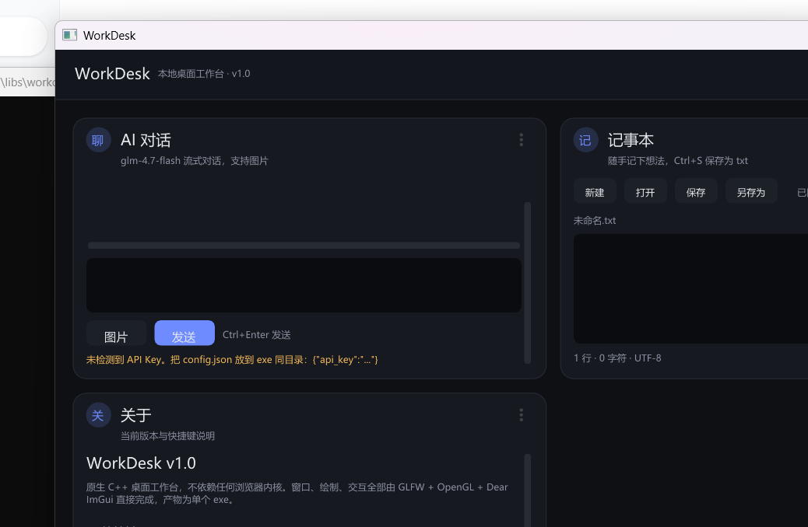

# WorkDesk

桌面端多 AI 聚合客户端。原生 Qt 实现，非网页套壳 —— 一个窗口统管多个 AI 服务、配置档案与对话风格，文件图片直接拖进来就能发；同窗口还带记事本与本地音乐模块。

Windows 10/11 x64 · Qt 6 Widgets · 安装向导或解压即用



## 功能特性

**AI 对话**

- **多 AI 聚合**：多个 AI 服务并存，侧边栏一键切换，随时追加新服务。
- **配置档案管理**：每个服务独立保存端点、模型与参数，配置写入 `%APPDATA%\WorkDesk\config.json`。
- **性格调试**：为每个档案单独设定系统提示词与对话风格，切换服务即切换人格。
- **文件与图片直传**：拖拽或粘贴文件、截图直接发送，单文件上限 100MB。
- **文档上下文互通**：发请求前自动带上当前打开文档的开头片段作为上下文。
- **写回记事本**：回复内容可一键写入当前文档，附带「同意 / 不同意」确认条。

**记事本**

- 打开 / 保存 / 另存为、查找替换、行号栏、字数统计、撤销重做、字体字号、自动换行。
- Markdown 实时渲染，可一键隐藏标记符或切回纯文本编辑。
- 编码按 UTF-8 / GB18030 自动识别，并记住原编码，保存时按原编码写回。

**音乐**

- 本地曲库按文件夹分组，可导入文件夹或单曲、重扫、移出；曲库记录写入 `%APPDATA%\WorkDesk\music.json`。
- 封面 / 曲目信息 / 逐行歌词，顺序、单曲、随机三种播放模式。
- 音频文件拖进窗口即入库；dock 栏迷你播放器常驻，模块隐藏或切走时播放不中断。

**界面与系统集成**

- **原生 Qt 实现**：Qt 6 Widgets 重写，无 Electron、无内嵌浏览器，启动快、内存占用低。
- **卡片式布局**：模块卡片可拖动换位、可隐藏并在 dock 栏还原，窗口最小宽度随可见模块数收窄。
- **实时毛玻璃**：交由系统 DWM 材质绘制，CPU 零开销；系统不支持时回退到快照磨砂。
- **主题与全局细节**：深色 / 亮色 / 跟随系统 / 跟随时间，全局平滑滚动、自绘提示气泡、自适应工具栏、`Ctrl+Alt` Markdown 工具条。
- **系统集成**：登记到「控制面板 / 程序和功能」，自带 `Uninstall.exe` 卸载程序。

## 下载

官方下载页：<https://workdesk-qt.pages.dev>

安装程序（蓝奏云）：<https://www.ilanzou.com/s/xu5yE9sAT>

当前版本 **v1.1.2**（2026-11-22）· Windows 10/11 x64

- 安装包文件名：`WorkDesk-1.1.2-setup.exe`，双击运行安装向导即可完成安装，运行库已随包附带。
- 卸载：在「控制面板 / 程序和功能」里找到 WorkDesk，或直接运行安装目录下的 `Uninstall.exe`。
- 绿色用法：把程序目录整体带走即可；若不想被登记进系统列表，在 `WorkDeskQt.exe` 同目录放一个空的 `portable.txt`，或设置环境变量 `WORKDESK_NO_REGISTRY=1`。

## 使用

1. 安装到**不含中文与空格**的目录（或解压绿色版到同类路径）。
2. 双击 `WorkDeskQt.exe`。
3. 首次启动会进入欢迎向导，按步骤填写服务商、接口地址、模型与 API Key，可当场测试连通性，再设定对话性格与生日；走完或点「跳过」后不再弹出，之后也可在设置里修改。

本机数据位置：

| 内容 | 路径 |
| --- | --- |
| AI 配置（含生日、多套档案） | `%APPDATA%\WorkDesk\config.json` |
| 音乐曲库 | `%APPDATA%\WorkDesk\music.json` |
| 界面偏好（主题、布局尺寸） | `%APPDATA%\WorkDesk\WorkDeskQt\ui.ini` |
| 启动日志 | `%APPDATA%\WorkDesk\WorkDeskQt\boot.log` |

> API Key 仅保存在本机，不随程序分发、不上传任何服务器。启动日志可用环境变量 `WORKDESK_NO_BOOTLOG=1` 关闭。

## 从源码构建

环境要求：Windows 10/11 x64、Qt 6.8+（msvc2022_64，需 Widgets、Network、Multimedia 模块）、CMake 3.21+、Ninja、Visual Studio（含「使用 C++ 的桌面开发」）。

一键构建（推荐）：先按本机实际路径改好 `build.ps1` 顶部的 `$root` / `$qt` / `$cmake` / `$ninja` / `$deploy` / `$appDir` 六个变量，再执行：

```powershell
powershell -ExecutionPolicy Bypass -File .\build.ps1
```

脚本会依次完成：调用 VS 的 `vcvars64.bat` → CMake 配置（Ninja / Release）→ 编译 → 清空并重建部署目录 → 复制 `Uninstall.exe` → `windeployqt` 部署运行库 → 逐个比对 DLL 哈希并自愈修复残缺文件。

手动构建：

```powershell
cmake -S . -B build -G Ninja -DCMAKE_BUILD_TYPE=Release -DCMAKE_PREFIX_PATH=C:/Qt/6.12.0/msvc2022_64
cmake --build build
```

产物为 `build\WorkDeskQt.exe` 与 `build\Uninstall.exe`，两者需放在同一目录（卸载程序据此定位安装位置）。发布前用 `windeployqt` 补齐运行库：

```powershell
C:/Qt/6.12.0/msvc2022_64/bin/windeployqt.exe --release --no-translations build\WorkDeskQt.exe
```

说明：`CMakeLists.txt` 的 `target_include_directories` 中包含一个外部头文件目录 `D:/libs/include`，本机不存在时请改成自己的第三方头文件路径或直接删掉该目录项；`nlohmann/json` 已内置于 `third_party/`，无需额外下载。

## 目录结构

```
src/                C++ 源码（主窗口、聊天面板、消息气泡、记事本、音乐模块、Markdown、语法高亮、HTTP、配置、会话、字体选择、主题、毛玻璃、平滑滚动、工具栏收放、提示气泡、系统集成、卸载程序）
assets/             图标资源
third_party/        nlohmann/json 单头文件
docs/               官网静态页与界面截图
CMakeLists.txt      构建定义（主程序 + Uninstall 两个目标）
assets.qrc          图标资源清单
workdesk.rc         exe 图标资源段
build.ps1           一键编译、部署与 DLL 自愈脚本
```

## 更新日志

### v1.1.2 — 2026-11-22

- 新增音乐模块：本地曲库（按文件夹分组、导入/重扫/移出）、封面与曲目信息、逐行歌词、顺序/单曲/随机三种模式，音频拖入即播放。
- 新增 dock 栏迷你播放器，模块隐藏或切换时播放不中断。
- 新增首次启动欢迎向导：分步配置 AI 服务并可测试连通性，最后设定性格与生日。
- 新增生日彩蛋：生日当天弹一次蛋糕动画，按空格吹灭蜡烛后可许愿。
- 新增全局 Markdown 工具条（`Ctrl+Alt` 呼出，`1~9` 套用格式）。
- 记事本新增 Markdown 实时渲染与「隐藏标记符」开关；新增 AI 写回与「同意 / 不同意」确认条，整次写回只占一步撤销。
- 新增 `Uninstall.exe` 卸载程序，并将程序登记进「控制面板 / 程序和功能」。
- 主窗口支持卡片拖动换位、模块隐藏与 dock 还原，窗口最小宽度随可见模块数收窄。
- 工具栏改为自适应收放（次要按钮收进「⋯」菜单），提示气泡改为随主题换色的自绘气泡。
- 实时毛玻璃改由 DWM 系统材质承担；启动日志补记 Qt 日志与未处理异常信息。
- 提供 Windows 安装程序 `WorkDesk-1.1.2-setup.exe`；源码仓库公开。

### v1.1.1 — 2026-11-21

- 新增窗口毛玻璃效果：接入系统 DWM 亚克力材质，自绘磨砂面板兜底，系统不支持时自动降级为纯色。
- 新增可搜索字体选择器：设置里的字体下拉框支持输入关键字即时过滤。
- 新增平滑滚动：长对话滚动带缓动，不再逐行跳动。
- 主题与绘制代码拆分为独立模块，配色与磨砂参数统一管理；笔记面板重构。
- 已知问题：桌面 dock 收起时屏幕右侧可能短暂残留残影，下一版本修复。

### v1.1.0 — 2026-11-15

- 新增多 AI 配置管理（profiles），可并存任意数量的服务档案。
- 新增性格调试选项，为每个档案单独设定系统提示词。
- 新增文件与图片路径传递，单文件上限 100MB。
- 新增粘贴文件与截图发送。

## 许可证

[MIT](LICENSE)
